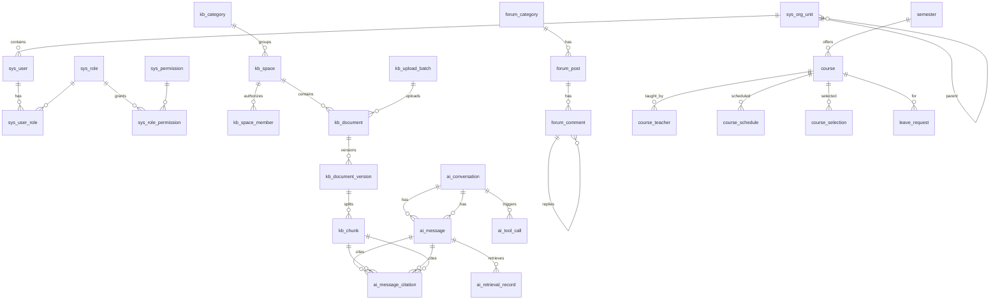

# 03 数据库设计

## 1. 通用约定

- 引擎 InnoDB，字符集 `utf8mb4`，排序规则 `utf8mb4_0900_ai_ci`。
- 主键为 `id BIGINT AUTO_INCREMENT`；关联表使用复合主键。
- 时间字段为 `DATETIME(3)`，按业务时区（Asia/Shanghai）存储。`created_at`/`updated_at` 由应用自动填充，数据库设有默认值兜底。
- 需要追溯操作人的表带 `created_by`/`updated_by`（用户 ID）；存在并发修改的表带 `version`（乐观锁）。
- 状态使用 `VARCHAR` 保存枚举名，由应用层枚举约束。
- 删除策略：
  - 用户：不物理删除，只停用。
  - 业务内容（文档、帖子、评论、课程）：软删除，即 `status = DELETED` 并记录 `deleted_at`/`deleted_by`。
  - 派生数据（文档块）：随文档失效同步标记或删除。
  - 关联关系（用户-角色等）：物理删除。
  - 审计日志：只追加，不删除。
- 外键：核心归属关系使用外键（`ON DELETE RESTRICT` 为主，纯关联表用 `CASCADE`）。审计、AI 调用日志等追溯类表不设外键，保证写入不受关联数据变化的影响。
- JSON 列只用于结构确实不固定的数据（例如待确认工具调用的参数快照），普通业务字段不使用 JSON。
- 迁移脚本位于 `src/main/resources/db/migration`，命名为 `V{n}__{desc}.sql`。已发布的脚本不再修改。

## 2. 迁移规划

| 版本 | 内容 | 阶段 | 状态 |
|---|---|---|---|
| V1 | 组织单元、用户、角色、权限、关联表、审计日志；内置角色与权限点 | 一 | **已完成** |
| V2 | 知识库：分类、空间、成员与授权范围、上传批次、文档、文档版本、文档块（ngram 全文索引） | 三 | **已完成** |
| V3 | 检索标题字段 + 标题 ngram 索引 + AI 问答（对话、消息、检索记录、引用） | 四 | **已完成** |
| V4 | 论坛：分类、帖子、评论（两级回复） | 五 | **已完成** |
| V5 | 课程：学期、课程、授课教师、排课、选课、请假；并为 `kb_space.scope_course_id` 补课程外键 | 六 | **已完成** |
| V6 | AI 工具调用：`ai_tool_call`（参数快照、待确认预览、状态机、确认过期、结果摘要） | 七 | **已完成** |

阶段二没有新增迁移脚本：登录锁定、`token_version`、组织树与用户管理所需的字段已在 `V1` 中预留并由阶段二代码启用。阶段三新增 `V2__init_knowledge.sql`，阶段四新增 `V3__init_ai_and_search.sql`，阶段五新增 `V4__init_forum.sql`，阶段六新增 `V5__init_course.sql`，阶段七新增 `V6__init_ai_tool.sql`。**阶段八未新增迁移**（系统测试与部署文档不涉及结构变更）。后续阶段继续按 `V7+` 追加，不修改已发布的 `V1`–`V6`。

## 3. ER 概览

## 4. 已实现的表（V1）

### sys_org_unit 组织单元
| 字段 | 类型 | 说明 |
|---|---|---|
| id | BIGINT PK | |
| parent_id | BIGINT FK→sys_org_unit | 顶级为空；删除受限 |
| code | VARCHAR(64) UK | 组织编码，大小写不敏感唯一 |
| name | VARCHAR(128) | |
| type | VARCHAR(16) | COLLEGE/DEPARTMENT/MAJOR/CLASS，上级 rank 必须更小 |
| status | VARCHAR(16) | ACTIVE/DISABLED |
| sort_order | INT | 同级排序，越小越靠前 |

结构约束由应用保证：最多 4 层、可跨级、不能成环；停用前全部直接下级必须已停用；启用时上级必须启用。变更时先 `SELECT * FROM sys_org_unit ORDER BY id FOR UPDATE` 锁定整棵树。

### sys_user 用户
| 字段 | 类型 | 说明 |
|---|---|---|
| username | VARCHAR(64) UK | 学号/工号，大小写不敏感唯一 |
| password_hash | VARCHAR(100) | `{bcrypt}...` |
| display_name / email(UK) / phone | | 邮箱可空且全局唯一 |
| org_unit_id | FK→sys_org_unit | 可空；只能指向启用组织 |
| status | VARCHAR(16) | ACTIVE/DISABLED/LOCKED |
| token_version | INT | 自增后旧令牌全部失效（退出/改密/重置/停用/锁定） |
| failed_login_count / locked_until | | 连续失败计数与临时锁定截止时间 |
| last_login_at / password_changed_at | | |
| version | INT | 乐观锁；登录计数不递增它 |

### sys_role / sys_permission / sys_user_role / sys_role_permission
- `sys_role.code`、`sys_permission.code` 唯一；`built_in = TRUE` 的内置角色不可删除。
- 权限点编码格式为 `模块:资源:动作`，V1 预置 25 个。ADMIN 拥有全部权限点；TEACHER、STUDENT 的默认授权如下：

| 权限点 | ADMIN | TEACHER | STUDENT |
|---|:-:|:-:|:-:|
| user:read / user:manage / role:manage / org:manage | ✓ | | |
| kb:space:read | ✓ | ✓ | ✓ |
| kb:space:create / kb:document:write | ✓ | ✓ | |
| kb:space:manage_all / kb:category:manage | ✓ | | |
| ai:chat / ai:tool:use | ✓ | ✓ | ✓ |
| forum:post:write / forum:comment:write | ✓ | ✓ | ✓ |
| forum:moderate / forum:category:manage | ✓ | | |
| course:read | ✓ | ✓ | ✓ |
| course:manage_own | ✓ | ✓ | |
| course:manage_all | ✓ | | |
| selection:select | ✓ | | ✓ |
| selection:manage_all | ✓ | | |
| leave:submit | ✓ | | ✓ |
| leave:review | ✓ | ✓ | |
| leave:manage_all | ✓ | | |
| audit:read / system:config | ✓ | | |

权限点只表示“能否执行某类操作”。“能否操作某一条数据”由业务服务按归属判断，例如持有 `kb:document:write` 的教师只能写自己获授权的知识库。

### 阶段二数据语义

- **令牌版本**：JWT 携带 `ver`。退出、本人改密、管理员重置密码、停用/锁定时 `token_version = token_version + 1`；重新启用不会恢复旧令牌。角色变更不递增版本，因为每个请求都重新加载角色。
- **临时锁定**：`failed_login_count` 达到阈值时写入 `locked_until`；锁定期间不再累加计数；成功登录清零。管理员“解锁”和“启用”都会清零失败计数并清除 `locked_until`。
- **管理员保护**：停用/锁定管理员或移除 ADMIN 角色前，按 ID 顺序对全部 ACTIVE 管理员行加 `FOR UPDATE` 锁，并在锁内重新计数；至少保留一个可用管理员。
- **组织状态**：`sys_org_unit.status` 只控制可见性与可分配性，不做级联更新；应用在停用/启用时校验上下级状态。组织不物理删除。
- **审计动作**：`LOGIN`、`LOGOUT`、`PASSWORD_CHANGE`、`ACCOUNT_TEMP_LOCKED`、`USER_CREATE`、`USER_UPDATE`、`USER_STATUS_CHANGE`、`USER_UNLOCK`、`USER_ROLES_ASSIGN`、`USER_PASSWORD_RESET`、`USER_MANAGE`（越权拒绝）、`ORG_CREATE`、`ORG_UPDATE`、`ORG_DISABLE`、`ORG_ENABLE`。
- **审计 detail**：只记录变更摘要（如角色集合、组织 ID、失败原因、失败次数），不记录密码、令牌原文或请求体。

### 知识库表（V2）

| 表 | 作用 | 关键约束/索引 |
|---|---|---|
| `kb_category` | 两级分类树 | 生成列 `parent_key` + `UNIQUE(parent_key,name)` 保证顶级分类也唯一；删除前检查子分类/空间 |
| `kb_space` | 知识库空间 | `visibility` PUBLIC/ORG/PRIVATE/COURSE；`version` 乐观锁；owner/org/category 外键 |
| `kb_space_member` | 成员授权 | `UNIQUE(space_id,user_id)`；owner 也写入一行 MANAGER |
| `kb_upload_batch` | 批量上传批次 | 记录 total/success/failed 和 COMPLETED/PARTIAL/FAILED |
| `kb_document` | 文档 | `UNIQUE(space_id,source_path)` 支持导入幂等（普通上传 source_path 为 NULL）；软删除；`version` 乐观锁 |
| `kb_document_version` | 不可变 Markdown 版本 | `UNIQUE(document_id,version_no)`；content MEDIUMTEXT；content_hash/size |
| `kb_chunk` | 检索块 | `UNIQUE(version_id,chunk_index)`；`FULLTEXT(heading_path,content) WITH PARSER ngram`；status ACTIVE/STALE；embedding_status/vector_id 预留 |

文档生命周期：创建/编辑插入新版本，旧版本块 `STALE`；删除只改 `kb_document.status`；重处理删除当前版本块后重建。`kb_chunk.space_id` 是冗余列，供阶段四检索先按空间权限过滤。

### audit_log 审计日志
包含 trace_id、操作人（ID 与用户名快照）、source（API/AI_TOOL/SYSTEM）、module、action、target_type/target_id、result（SUCCESS/FAILURE/DENIED）、error_code、detail（已脱敏的 JSON 摘要，≤2000 字符）、client_ip、user_agent、created_at。索引：`(actor_user_id, created_at)`、`(module, action, created_at)`、`(target_type, target_id)`、`created_at`。

## 5. 数据设计（按迁移版本）

### 5.1 知识库（V2，已完成）

| 表 | 关键字段 | 约束/索引 |
|---|---|---|
| kb_category | parent_id, name, sort_order | 生成列 parent_key + UK(parent_key, name) |
| kb_space | category_id, name, description, visibility(PUBLIC/ORG/COURSE/PRIVATE), scope_org_unit_id, scope_course_id, owner_user_id, status(ACTIVE/ARCHIVED/DELETED), version | idx(visibility, status)、idx(owner_user_id) |
| kb_space_member | space_id, user_id, member_role(MANAGER/EDITOR/VIEWER), granted_by | **UK(space_id, user_id)** |
| kb_upload_batch | space_id, uploader_id, total_count, success_count, failed_count, status | idx(space_id, created_at) |
| kb_document | space_id, batch_id, title, original_filename（清洗后）, source_type(UPLOAD/EDITOR/IMPORT), source_path, current_version_id, status(ACTIVE/DELETED), process_status(PENDING/PROCESSING/INDEXED/FAILED), process_error, content_hash(SHA-256), effective_from, effective_to, uploaded_by, deleted_at/deleted_by, version | idx(space_id, status)、idx(process_status)、**UK(space_id, source_path)**（普通上传为 NULL） |
| kb_document_version | document_id, version_no, content(MEDIUMTEXT 原文), content_hash, size_bytes, change_note, created_by | UK(document_id, version_no) |
| kb_chunk | document_id, version_id, space_id（冗余，用于检索权限过滤）, document_title（标题加权）, chunk_index, heading_path（如“第二章 > 2.1 奖学金”）, content, char_count, token_estimate, status(ACTIVE/STALE), embedding_status(NONE/PENDING/DONE/FAILED), vector_id | UK(version_id, chunk_index)、idx(space_id, status)、**FULLTEXT(document_title)**、**FULLTEXT(heading_path, content) WITH PARSER ngram** |

处理规则：
- 上传或编辑时生成新的 `kb_document_version`，旧版本的 chunk 置为 `STALE`，新版本的 chunk 置为 `ACTIVE`，这些操作在同一事务中完成。这样修改后检索不会再命中旧内容。
- 删除文档时，文档置为 `DELETED`，其全部 chunk 置为 `STALE`；阶段四接入 Qdrant 后还要同步删除对应向量点（失败时记录待补偿状态）。
- 检索条件始终包含 `kb_chunk.status = 'ACTIVE'`，并按阶段四计算的 `space_id` 集合过滤；回答涉及时效的问题时，额外按 `effective_from/effective_to` 过滤或标注。
- 批次中每个文件独立处理和提交，单个文件失败不影响其他文件；失败的文档保留 `process_error`，可以重新处理。

### 5.2 AI 问答（V3，已完成）

| 表 | 关键字段 | 说明 |
|---|---|---|
| ai_conversation | user_id, title, status(ACTIVE/DELETED), last_message_at | idx(user_id, status, last_message_at) |
| ai_message | conversation_id, role(USER/ASSISTANT), content, model, prompt_tokens, completion_tokens, token_source(REAL/ESTIMATED), latency_ms, status(SUCCESS/FAILED/NO_EVIDENCE), error_code | idx(conversation_id, id) |
| ai_retrieval_record | message_id（助手消息）, query_text, rewritten_query, strategy(KEYWORD/VECTOR/HYBRID), candidate_count, selected_count, context_tokens, latency_ms | 一次问答一条 |
| ai_message_citation | message_id, chunk_id, document_id, version_id, rank_no, score, used_in_context, snippet | 回答与来源对应；chunk 不设外键，保留历史追溯 |

`ai_tool_call` 不属于阶段四，已在阶段七通过 V6 追加（见 5.5）。检索标题字段 `kb_chunk.document_title` 由 V3 回填并建立独立 ngram FULLTEXT 索引；新块写入时由文档标题填充。

### 5.3 论坛（V4，已完成）

| 表 | 关键字段 | 约束/索引 |
|---|---|---|
| `forum_category` | name, description, sort_order, status(ACTIVE/DISABLED), created_by/updated_by | **UK(name)**；idx(status, sort_order)；扁平结构，无上级字段 |
| `forum_post` | category_id, author_id, title, content, status(PUBLISHED/HIDDEN/DELETED), pinned, comment_count, last_activity_at, deleted_at/deleted_by, version | idx(category_id,status,pinned,last_activity_at)、idx(author_id,status,last_activity_at)、idx(status,pinned,last_activity_at)；**FULLTEXT(title,content) WITH PARSER ngram** |
| `forum_comment` | post_id, parent_id, root_id, author_id, reply_to_user_id, content(VARCHAR 2000), status(PUBLISHED/DELETED), deleted_at/deleted_by | idx(post_id,root_id,id)、idx(post_id,parent_id,id)、idx(author_id,id)；post/parent/root/author/reply_to 外键 |

语义与索引说明：

- **帖子状态**：`PUBLISHED` 正常展示；`HIDDEN` 仅作者本人和 `forum:moderate` 可见，作者可继续修改但修改后仍为隐藏；`DELETED` 为软删除，所有读取接口 404。列表默认只查 `PUBLISHED`，版主可按 `HIDDEN` 过滤；`DELETED` 不能通过状态接口设置。
- **分类状态**：`DISABLED` 后其下帖子对普通用户（含作者）不可见，也不能新建/修改到该分类；分类列表默认只返回 ACTIVE，`includeDisabled=true` 需要 `forum:category:manage`。分类删除前要求没有任何帖子（含软删除帖子，外键 `ON DELETE RESTRICT`）。
- **评论两级**：顶级评论 `parent_id`、`root_id` 均为 NULL；回复的 `root_id` 指向顶级评论，`parent_id` 指向被回复的评论。回复一条回复时仍使用同一 `root_id`，前端/接口按 root 组装成“顶级评论 + 回复列表”，因此不需要递归查询。顶级评论删除时级联软删除同 root 的全部回复；删除单条回复只处理自身。
- **计数与并发**：`forum_post.comment_count` 只统计 `PUBLISHED` 评论。评论创建/删除在事务内先对帖子行 `SELECT ... FOR UPDATE`，再写评论并增减计数，避免并发丢计数、给已删除帖子追加评论或与帖子删除竞争。`version` 只跟踪帖子内容修改，评论计数/最后活跃时间更新不递增 `version`。
- **检索**：`FULLTEXT(title, content)` 使用 ngram，应用层用 `SearchTerms` 把中文拆成 2 字 ngram 后以 `BOOLEAN MODE` 查询；列表排序为置顶优先、其次 `last_activity_at` 倒序，关键词检索在同等置顶下按相关度排序。
- **软删除追溯**：帖子和评论均保留原文、`deleted_at/deleted_by`；审计日志另记操作人、动作和标题/ID 摘要，不保存正文全文。

### 5.4 课程、选课、请假（V5，已完成）

| 表 | 关键字段 | 约束/索引 |
|---|---|---|
| `semester` | code, name, start_date, end_date, selection_start_at, selection_end_at, status(DRAFT/ACTIVE/CLOSED) | **UK(code)**；idx(status, start_date, end_date)；CHECK 起止日期/选课窗口有序 |
| `course` | semester_id, code, name, credit(DECIMAL(3,1)), description, org_unit_id, capacity, selected_count, status(DRAFT/OPEN/CLOSED/CANCELLED), version | **UK(semester_id, code)**；idx(semester_id, status, id)、idx(org_unit_id)；**CHECK(selected_count BETWEEN 0 AND capacity)** |
| `course_teacher` | course_id, teacher_id, teacher_role(PRIMARY/ASSISTANT) | **PK(course_id, teacher_id)**；idx(teacher_id, course_id)；course 级联删除、teacher 限制删除 |
| `course_schedule` | course_id, day_of_week(1–7), start_period, end_period, start_week, end_week, week_parity(ALL/ODD/EVEN), classroom | idx(course_id, day_of_week, start_period)；CHECK 星期/节次/周次区间；随课程级联删除 |
| `course_selection` | course_id, student_id, status(SELECTED/DROPPED), **active_key 生成列**, selected_at, dropped_at | **UK(course_id, student_id, active_key)** 防重复选课且允许退课后重选；idx(student_id, status, course_id)、idx(course_id, status) |
| `leave_request` | student_id, course_id, schedule_id, start_at, end_at, reason, status(PENDING/APPROVED/REJECTED/CANCELLED), reviewer_id, review_comment, reviewed_at, version | idx(student_id, created_at)、idx(course_id, status, id)、idx(status, id)；CHECK(start_at < end_at)；schedule 删除时置空 |

语义与并发说明：

- **学期状态**：`DRAFT` 可建课但不能选课；`ACTIVE` 且当前时间在选课窗口内才允许选课/退课；`CLOSED` 为终态，不能再建课、改课、排课或变更状态。选课窗口与学期起止日期相互独立，因此不要求窗口落在学期范围内。
- **课程容量**：`selected_count` 是冗余计数，只由选课服务通过条件更新维护（选课 +1、退课 −1、停开清零）；数据库 `CHECK(selected_count <= capacity)` 是兜底，所以缩小容量前服务层必须先校验“容量 ≥ 已选人数”，否则会触发约束错误。
- **课程状态与停开**：`OPEN` 前必须已排课；`CANCELLED` 为软删除终态，停开时在同一事务内批量把有效选课置为 `DROPPED`、`selected_count` 清零、该课程 `PENDING` 请假置为 `CANCELLED`。停开课程对普通用户表现为 404。
- **选课唯一性与重选**：`active_key TINYINT GENERATED ALWAYS AS (IF(status='SELECTED',1,NULL)) STORED`，配合 `UNIQUE(course_id, student_id, active_key)`。`SELECTED` 行只能有一条，`DROPPED` 行的 `active_key` 为 NULL（唯一键不约束 NULL），因此退课后可以重新选课，同时保留全部历史记录。
- **选课并发**：事务内先锁学生行（`sys_user`），再锁课程行（`course`），然后条件更新占用名额。锁顺序固定为“学生 → 课程”，避免死锁；同一学生对同一门课的并发选课会被学生行锁串行化。
- **排课冲突**：不建数据库约束，由应用层 `ScheduleConflict` 按“同一天 + 节次区间相交 + 周次区间相交 + 单双周不互斥”判定。同一课程内不重叠、同一教师的其它课程不重叠；单双周互斥的排课可以占用同一时间段。
- **请假状态机**：`PENDING → APPROVED | REJECTED`（任课教师或管理员）、`PENDING → CANCELLED`（申请人本人），其余转换一律拒绝；状态更新使用 `WHERE status = 'PENDING'` 条件更新，并发审批只有一个成功。`version` 记录审批/撤销引起的状态变更，`schedule_id` 只做归属校验（可为空，表示按天请假）。
- **知识库联动**：`kb_space.scope_course_id` 在 V5 补上外键指向 `course(id)`（`ON DELETE RESTRICT`）；课程只停开不物理删除，因此不会阻碍业务。

### 5.5 AI 工具调用（V6，已完成）

| 表 | 关键字段 | 约束/索引 |
|---|---|---|
| `ai_tool_call` | conversation_id, user_id, tool_name, side_effect, arguments_json(JSON), argument_summary, preview, status(PENDING_CONFIRM/EXECUTING/SUCCEEDED/FAILED/REJECTED/EXPIRED), result_summary, error_code, error_message, confirm_expires_at, confirmed_at, executed_at, latency_ms, version | idx(user_id, created_at)、idx(status, confirm_expires_at)、idx(conversation_id, id)、idx(tool_name, created_at)；user 限制删除、conversation 级联删除 |

语义说明：

- **参数快照**：`arguments_json` 保存调用方（模型/前端）实际传入的参数，用于追溯“当时到底传了什么”；`argument_summary` 是截断后的可读摘要，供列表与审计展示，避免解析 JSON。
- **结果不落大对象**：只保存 `result_summary`（≤2000 字）；完整业务对象仅在本次响应中返回，避免表膨胀与重复存储。
- **状态机**：只读工具直接写入 `SUCCEEDED/FAILED`；写操作工具先写 `PENDING_CONFIRM`，确认时条件更新为 `EXECUTING`（认领），执行后终结为 `SUCCEEDED/FAILED`；拒绝为 `REJECTED`，超时为 `EXPIRED`。`EXECUTING` 是短暂状态，用于保证并发确认只执行一次。
- **确认有效期**：`confirm_expires_at` 由 `app.ai.tool.confirm-ttl`（默认 10 分钟）生成；认领条件包含 `confirm_expires_at > now`，因此过期记录无法被确认，会被标记为 `EXPIRED`。
- **审计**：调用/确认/拒绝/过期都写 `audit_log`（`source=AI_TOOL`），表本身不重复保存审计字段。

### 5.6 校务服务（V10，已完成）

| 表 | 关键字段 | 约束/索引 |
|---|---|---|
| `grade_rule` | name, min_score, max_score, grade_point, grade_level, sort_order | `UNIQUE(min_score, max_score)`；CHECK 区间与绩点范围；内置 4.0 制十档 |
| `course_grade` | course_id, student_id, score, grade_point, grade_level, status(DRAFT/PUBLISHED), remark, graded_by, published_at, version | `UNIQUE(course_id, student_id)`；`idx(student_id, status)`；course 级联删除、student 限制删除 |
| `teaching_evaluation` | semester_id, course_id, teacher_id, student_id, 四个维度分, total_score, comment, anonymous | `UNIQUE(course_id, teacher_id, student_id)`（每生每课每师一次）；teacher/student 索引 |
| `campus_feedback` | category, title, content, anonymous, student_id, status(OPEN/PROCESSING/RESOLVED/CLOSED), handler_id, reply, replied_at, version | `idx(status, id)`、`idx(student_id, id)`；handler 删除时 SET NULL |
| `class_counselor` | class_id, counselor_id | 复合主键；两侧外键均级联 |
| `leave_approval` | leave_id, stage, approver_role(TEACHER/COUNSELOR/ADMIN), approver_id, decision, comment, decided_at | `UNIQUE(leave_id, stage)` 保证同级只有一个结论；leave 级联删除 |
| `attendance_session` | course_id, schedule_id, class_id, session_date, start_period, end_period, status(DRAFT/FINAL), note, version | `UNIQUE(course_id, class_id, session_date, start_period)`；`idx(class_id, session_date)` |
| `attendance_record` | session_id, student_id, status(PRESENT/ABSENT/LATE/LEAVE), leave_id, remark | `UNIQUE(session_id, student_id)`；session 级联删除 |
| `platform_setting` | setting_key, setting_value, description, updated_by | 主键 `setting_key`，值为字符串 |

语义说明：

- **成绩快照**：`grade_point`/`grade_level` 在保存时按当时的 `grade_rule` 换算并落库，之后调整规则不会改写历史成绩；发布只把 `DRAFT` 且已录分数的行改为 `PUBLISHED`。
- **评教匿名**：`student_id` 用于唯一约束与追溯，接口不向教师返回；留言与总分只做聚合。
- **请假流程快照**：`approval_order`、`total_stages`、`current_stage` 在提交时固化，`leave_approval` 是逐级流水；状态更新条件包含 `current_stage`，同一级并发只有一人成功。
- **销假**：只写 `revoked_at/revoke_note/revoked_by`，不改 `status`，用 `AND revoked_at IS NULL` 防重复销假。
- **考勤唯一性**：同一班同一门课同一天同一开始节次只能有一个场次；`attendance_record` 一人一条，重复登记由唯一键拦截。
- **设置项**：`leave.approval.teacher/counselor/order`、`evaluation.anonymous`、`grade.gpa.scale`；写入前校验「教师与导员不能同时关闭」。

### 5.7 通知、考勤申诉与教室借用（V11，已完成）

| 表 | 关键字段 | 约束/索引 |
|---|---|---|
| `notification` | user_id, category, level, title, body, link_url, biz_type, biz_id, read_at | `idx(user_id, read_at, id)`、`idx(biz_type, biz_id)`；user 级联删除 |
| `notification_delivery` | notification_id, channel(EMAIL/WECHAT), status, attempts, last_error, sent_at | `UNIQUE(notification_id, channel)`；notification 级联删除 |
| `attendance_appeal` | record_id, student_id, reason, target_status, status(PENDING/APPROVED/REJECTED), reviewer_id, review_comment, reviewed_at, version | `UNIQUE(record_id)`；`idx(student_id, status, id)`、`idx(status, id)` |
| `attendance_warning` | student_id, course_id, absent_count | `UNIQUE(student_id, course_id, absent_count)`，同一门槛只提醒一次 |
| `room_booking` | room_id, applicant_id, booking_date, start_period, end_period, purpose, attendees, status, reviewer_id, version | `idx(room_id, booking_date, status)`、`idx(applicant_id, id)`、`idx(status, id)` |

语义说明：

- **通知独立事务**：站内信在 `NotificationWriter` 的 REQUIRES_NEW 事务中写入，避免通知失败回滚业务；渠道投递状态单独记录，未接入的发送器写 `SKIPPED`。
- **申诉唯一性**：`UNIQUE(record_id)` 保证一条考勤明细只有一条申诉；审核通过后直接改 `attendance_record.status`，不新增考勤行。
- **预警去重**：以 `(student_id, course_id, absent_count)` 唯一键控制「同一累计次数只提醒一次」，后续达到更高次数会再提醒。
- **借用冲突**：数据库不建区间约束，申请与审批时分别校验课表占用与已批准借用；审批使用 `WHERE status='PENDING'` 条件更新。

### 5.8 论坛通知与官方公告（V12，已完成）

| 变更 | 字段 | 说明 |
|---|---|---|
| `forum_category` | `announcement BOOLEAN NOT NULL DEFAULT FALSE` | 公告分类：发帖需 `forum:announce`，发布后广播全员 |
| `notification` | `popup_required BOOLEAN NOT NULL DEFAULT FALSE` | 登录后弹窗提示；弹窗关闭即写 `read_at` |
| `notification` | `KEY idx_notification_popup (user_id, popup_required, read_at, id)` | 弹窗查询走该索引 |

语义说明：

- **公告分类**：只是分类上的一个标记，不新增表；帖子仍在 `forum_post` 里，评论、置顶、隐藏等能力完全复用。
- **广播**：`INSERT INTO notification SELECT ... FROM sys_user WHERE status='ACTIVE'` 一条语句写完，
  不逐用户开事务；发布者用 `excludeUserId` 排除。`roleCode` 为空表示全校，预留给按角色定向。
- **弹窗标记**：`popup_required` 与 `read_at` 组合出「待弹窗」集合；关闭弹窗即标记已读，天然幂等、不会重复弹。
- **通知分类**：新增 `FORUM`（论坛互动）与 `ANNOUNCEMENT`（官方公告），前端按分类分组与筛选。

### 5.9 论坛限时置顶（V13，已完成）

| 变更 | 字段 | 说明 |
|---|---|---|
| `forum_post` | `pinned_until DATETIME(3) NULL` | 置顶到期时间；`NULL` 表示长期置顶 |
| `forum_post` | `KEY idx_forum_post_pin (pinned, pinned_until, last_activity_at)` | 列表按「有效置顶」排序时避免全表排序 |

语义说明：

- **有效置顶**：`pinned = TRUE AND (pinned_until IS NULL OR pinned_until > NOW(3))`，
  排序 SQL 与 Java 视图（`isPinned`）用同一口径，过期后自动回到普通排序，无需定时任务清理。
- **只改状态不改置顶**：`PATCH /forum/posts/{id}/status` 不传 `pinned` 时保留原到期时间，
  避免「隐藏再恢复」把置顶期限重置；若该置顶已过期，则顺手把 `pinned` 与 `pinned_until` 清空。
- **视图不暴露过期值**：已失效的置顶在接口里返回 `pinned = false`、`pinnedUntil = null`。

### 5.10 个人资料与头像（V14，已完成）

| 变更 | 字段/表 | 说明 |
|---|---|---|
| `sys_user` | `avatar_version INT NOT NULL DEFAULT 0` | 上传/删除头像后自增，前端拼进图片 URL 做缓存失效 |
| `user_avatar` | user_id(PK), content_type, size_bytes, bytes MEDIUMBLOB, updated_at | 一人一张；随用户级联删除 |

语义说明：

- **二进制单独存放**：查用户、登录、列表都不会把图片读出来；只有 `/profile/avatar/{id}` 读 BLOB。
- **版本号而不是时间戳**：换头像后 `avatar_version+1`，接口地址变化即可绕开浏览器缓存，
  不依赖服务端时钟或多实例一致性。
- **校验在服务层**：Content-Type 白名单（PNG/JPEG/WebP）+ 文件头魔数双重校验，≤1.5MB。
